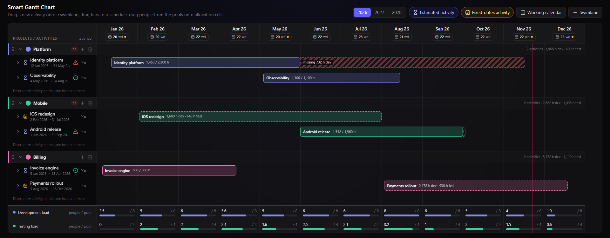
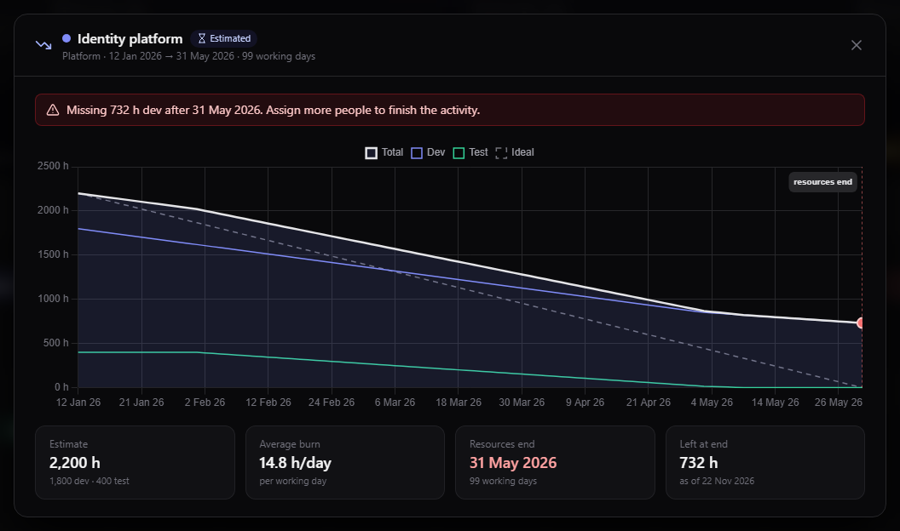

# Horizon

Horizon is a local roadmap planner. Staff a development pool and a testing pool, place work on a year-long Gantt chart, and see whether the plan fits the working calendar.

Plans stay in the browser. Export and import them as JSON from the header.

## Resource pool

Drag people from a pool onto an activity month. Headcount, working days, and effective hours set the capacity those assignments draw from.


## Smart Gantt

Swimlanes group activities. Estimated activities run until their hours are covered; fixed-date activities keep the span you set. The footer shows how many people each month uses, and the red line is today.



## Statistics

Year totals, monthly utilization, and activities that still need people.


## Working calendar

Weekends are off by default. Click a day to mark a holiday or a working weekend; that month’s working-day count feeds the plan.


## Burndown

Each activity can show remaining hours against an even burn, including work still left when the assigned people run out.



## Run

```sh
npm install
npm run dev
```

## Docker

```sh
docker compose up --build
```

The app is served at http://localhost:8080. Production deploy, behind the shared nginx-proxy, is described in [deployment.md](deployment.md).

## License

[MIT](LICENSE)
