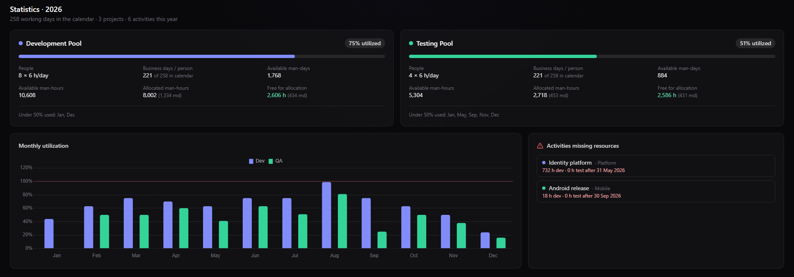

<p align="center">
  
</p>

# Horizon

Horizon is a smart Gantt chart for roadmap planning. Staff named resource pools (a developer pool and a testing pool to start, add as many as you need), lay the year's work on the chart, and see whether the plan fits the people you have and the days they actually work.

An estimated activity keeps running until the hours you assign cover its estimate. A fixed-date activity stays on the start and end you set. Weekends are off unless you mark a holiday or a working weekend, and those days change the capacity every assignment draws from. The chart footer shows how hard each pool is loaded each month. Statistics show utilization across the year and the activities that still need people. Any activity can open a burndown of remaining hours against an even burn.

The plan stays in this browser. Export it as JSON from the header, and import it again on another machine. Nothing about the plan is sent to a server.

## Resource pools

Every pool is a named list of people; by default a Developer Pool with 8 developers and a Testing Pool with 4 testers. Each person has their own efficient hours per day (6 by default), and one business-days-per-year setting applies to every pool.

Assign people to activities by dragging them onto a month in the chart or from the activity editor. Each assignment is a date range with a quota in % of FTE: the share of the person's efficient daily hours spent on the activity (100% = full time, 50% = half a day). One person can work on several activities in parallel, each with its own quota, and can have several ranges on one activity to change the quota over time. Ranges start and end on any working day. For an estimated activity you enter an estimate per pool, and the completion day follows from the assignments ("until done" ranges stop when the estimate is covered). For a fixed-date activity you set the start and end, and the end always falls on a working day. Load is checked day by day: when anyone's quotas on a working day add up to more than 1 FTE (their own efficient hours per day), a warning above the chart lists who, when, by how much, and which activities overlap.


## Smart Gantt

Swimlanes group activities. Estimated activities run until their hours are covered; fixed-date activities keep the span you set. The footer shows how many people each month uses, and the red line is today.


## Statistics

Year totals, monthly utilization, and activities that still need people.



## Working calendar

Weekends are off by default. Click a day to mark a holiday or a working weekend; that month’s working-day count feeds the plan.


## Burndown

Each activity can show remaining hours against an even burn, including work still left when the assigned people run out.


## Run

```sh
npm install
npm run dev
```

## Docker

```sh
docker compose up --build
```

The app is served at http://localhost:8080. Production deploy, behind the shared nginx-proxy, is described in [deployment.md](deployment.md).

## License

[MIT](LICENSE)
