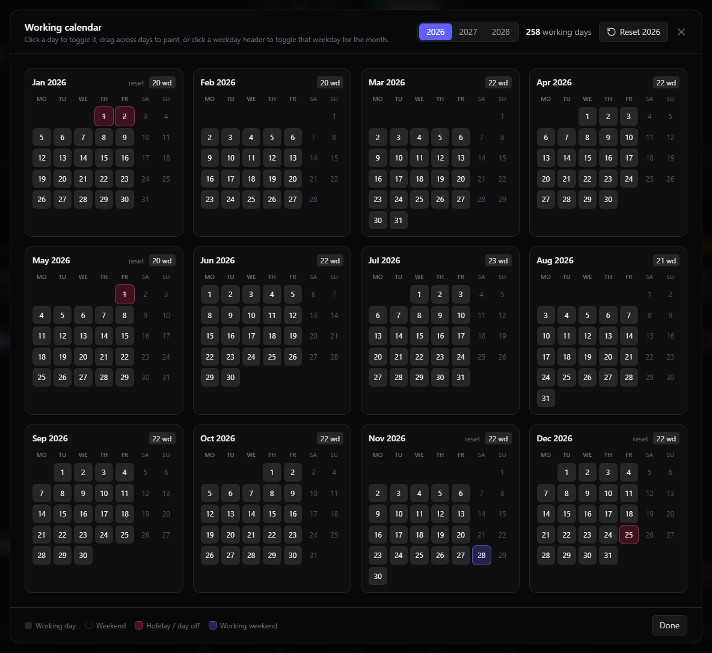

<p align="center">
  
</p>

# Horizon

Horizon is a smart Gantt chart for roadmap planning. Staff a development pool and a testing pool, lay the year's work on the chart, and see whether the plan fits the people you have and the days they actually work.

An estimated activity keeps running until the hours you assign cover its estimate. A fixed-date activity stays on the start and end you set. Weekends are off unless you mark a holiday or a working weekend, and those days change the capacity every assignment draws from. The chart footer shows how hard each pool is loaded each month. Statistics show utilization across the year and the activities that still need people. Any activity can open a burndown of remaining hours against an even burn.

The plan stays in this browser. Export it as JSON from the header, and import it again on another machine. Nothing about the plan is sent to a server.

## Resource pool

Drag people from a pool onto an activity month. Headcount, working days, and effective hours set the capacity those assignments draw from.


## Smart Gantt

Swimlanes group activities. Estimated activities run until their hours are covered; fixed-date activities keep the span you set. The footer shows how many people each month uses, and the red line is today.


## Statistics

Year totals, monthly utilization, and activities that still need people.


## Working calendar

Weekends are off by default. Click a day to mark a holiday or a working weekend; that month’s working-day count feeds the plan.



## Burndown

Each activity can show remaining hours against an even burn, including work still left when the assigned people run out.


## Run

```sh
npm install
npm run dev
```

## Docker

```sh
docker compose up --build
```

The app is served at http://localhost:8080. Production deploy, behind the shared nginx-proxy, is described in [deployment.md](deployment.md).

## License

[MIT](LICENSE)
